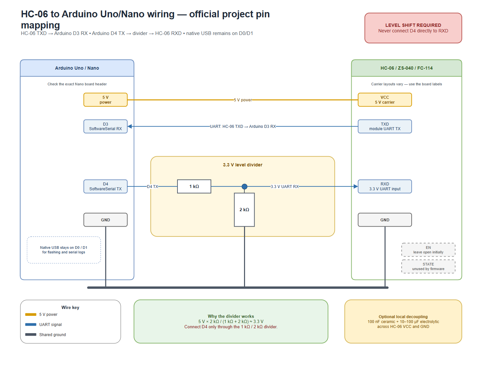

# IntegriScan breathalyzer firmware

Target hardware: 5 V Arduino Uno or ATmega328P Nano, MQ-3 on `A0`, passive
buzzer on `D8`, and a six-pin ZS-040/FC-114 HC-06 Bluetooth Classic module.

**Official project UART mapping:** HC-06 `TXD` connects to Arduino `D3`
(SoftwareSerial RX), while Arduino `D4` (SoftwareSerial TX) drives HC-06 `RXD`
through the required 1 kΩ / 2 kΩ divider.

> The earlier `D10` / `D11` mapping is **retired**. If you encounter a diagram showing the
> divider fed from `D11`, that is an old document — the 1 kΩ / 2 kΩ values in it are still
> correct, but it is the pin that changed. `D3` / `D4` is the only supported mapping.

The sketch stores these pins as the portable numeric values `3` and `4`.
Some Arduino board cores do not expose the `D3` and `D4` symbol aliases even
though those physical header pins are present; the numeric constants compile
across those cores without changing the Uno/Nano pin assignment.

Avoid `D3` for the buzzer if you ever rework this: `D3` is also a Timer2 PWM pin, and
`tone()` claims Timer2. The buzzer is on `D8` for that reason.

The sketch sends the same CRLF-delimited JSON telemetry to:

- USB serial on the Arduino's native `D0`/`D1` port; and
- HC-06 SPP at `9600` baud using `SoftwareSerial`.

USB serial remains separate, so the HC-06 does not have to be disconnected to
flash the Arduino. The first nine JSON fields (`raw`, `avg`, `peak`, `sn`,
`vout`, `rs`, `over`, `alarm`, `warm`) are unchanged in name, order and units,
so an existing app build keeps parsing the stream. This revision appends `seq`,
`up`, `vcc`, `spread`, `r0`, `fault`, `state` and a `crc` checksum (see
[Verify Bluetooth output](#verify-bluetooth-output) below). A record is now
about 200–230 bytes plus CRLF, so the blocking RFCOMM write of the longer line
is the dominant cost and the record period is roughly 0.5–0.7 s on an Uno/Nano
(**about one to two readings per second**). The old 200 ms `delay()` is gone: it
is now a non-blocking `millis()` wait that keeps servicing commands and the
watchdog; see the timing budget in the specification.

## Documentation

- [Technical specification](docs/TECHNICAL_SPECIFICATION.md): hardware, firmware, telemetry protocol, app integration, bench tests and known issues. Start here.
- Diagrams (PNG preview; the `.drawio` source embeds the XML and stays editable):

  | Diagram | PNG | Source |
  | --- | --- | --- |
  | 01 System architecture | [png](diagrams/01-system-architecture.drawio.png) | [drawio](diagrams/01-system-architecture.drawio) |
  | 02 Hardware wiring | [png](diagrams/02-hardware-wiring.drawio.png) | [drawio](diagrams/02-hardware-wiring.drawio) |
  | 03 Firmware state machine | [png](diagrams/03-firmware-state-machine.drawio.png) | [drawio](diagrams/03-firmware-state-machine.drawio) |
  | 04 Firmware loop and timing | [png](diagrams/04-firmware-loop-timing.drawio.png) | [drawio](diagrams/04-firmware-loop-timing.drawio) |
  | 05 Telemetry and capture sequence | [png](diagrams/05-telemetry-and-capture-sequence.drawio.png) | [drawio](diagrams/05-telemetry-and-capture-sequence.drawio) |
  | 06 Measurement pipeline | [png](diagrams/06-measurement-pipeline.drawio.png) | [drawio](diagrams/06-measurement-pipeline.drawio) |

- Wireframes of the console in the officer app:

  | Wireframe | PNG | Source |
  | --- | --- | --- |
  | 01 Console tabs | [png](wireframes/01-console-tabs.drawio.png) | [drawio](wireframes/01-console-tabs.drawio) |
  | 02 Console states and capture gates | [png](wireframes/02-console-states-and-gates.drawio.png) | [drawio](wireframes/02-console-states-and-gates.drawio) |

  Both wireframes cover the current three-tab console — Connect, Calibrate and Live — with the status hero and setup stepper shown on every tab. Wireframe 02 also lists the exact capture and calibration gate messages.

The prototype is not evidential. Section 11 of the specification lists the blocking items.

## HC-06 wiring

| ZS-040 pin | Connect to | Notes |
| --- | --- | --- |
| `VCC` | Arduino `5V` | The carrier accepts 3.6–6 V. Do not power it from `3V3`. |
| `GND` | Arduino `GND` | The Arduino and module must share ground. |
| `TXD` | Arduino `D3` | Module TX crosses to the Arduino SoftwareSerial RX input. Direct 3.3 V signal is safe. |
| `RXD` | `D4 → 1 kΩ → RXD`, with `2 kΩ` from `RXD` to `GND` | The divider reduces the Arduino's 5 V TX signal to approximately 3.3 V. |
| `EN` | Not connected initially | Carrier wiring varies. Use a 3.3 V normal-mode level only if the exact board documentation or continuity test requires it; never use 5 V. |
| `STATE` | Not connected | Optional connection-status output; the firmware does not use it. |

Protect the Arduino-to-HC-06 TX line with the 1 kΩ / 2 kΩ divider shown below:

[](./diagrams/hc06-arduino-wiring.drawio)

[Open the editable draw.io source](./diagrams/hc06-arduino-wiring.drawio).

Do **not** connect Arduino `D4` directly to HC-06 `RXD`; the direct 5 V signal
can damage the 3.3 V Bluetooth module. `D4` is the Arduino TX pin and must reach
`RXD` only through the 1 kΩ / 2 kΩ divider. `D3` is the Arduino RX pin and
connects directly to module `TXD`. Do not reverse `TXD` and `RXD`. Leave
`EN` open for the initial test because ZS-040/FC-114 clones wire it differently.
If the exact board is documented to require a high normal-mode level, connect
`EN` to 3.3 V (never 5 V).

For a longer power lead, add a `10-100 uF` electrolytic capacitor and a `100 nF`
ceramic capacitor across the module's `VCC` and `GND`, close to the module.
Power both boards from the same adequately rated 5 V source where possible.
Independently powering the HC-06 while USB drives the Arduino input can
back-power the module through `TXD`; use proper level translation if separate
power supplies are unavoidable. Ensure the Arduino's 5 V regulator has capacity
for the HC-06 (roughly 30–50 mA) plus the MQ-3 heater and other loads.

## Flash the firmware

Arduino IDE:

1. Disconnect USB power before changing wires.
2. Wire the HC-06 as shown above.
3. Open `firmware/breathalyzer/breathalyzer.ino`.
4. Select the exact board (`Arduino Uno` or `Arduino Nano`) and its COM/serial
   port.
5. Upload the sketch. The HC-06 can remain connected because the firmware does
   not use `D0`/`D1` for Bluetooth.
6. Open the serial monitor at `9600` baud. The MQ-3 warm-up flag (`warm`) is
   expected to stay `true` for at least the first 60 seconds, and up to 90 s if
   the reading is still settling.

Command-line equivalent when the Arduino CLI is installed:

```powershell
arduino-cli compile --fqbn arduino:avr:uno firmware/breathalyzer
arduino-cli upload -p <COM_PORT> --fqbn arduino:avr:uno firmware/breathalyzer
```

Use `--fqbn arduino:avr:nano` instead when compiling/uploading to a Nano.

Continuous integration compiles this sketch for both Arduino Uno and the
ATmega328P Nano with all warnings enabled
([`.github/workflows/firmware.yml`](../.github/workflows/firmware.yml)), so the
two supported boards cannot silently drift apart. The AVR core is installed with
`arduino-cli core install arduino:avr`.

## Verify Bluetooth output

1. Pair the module from Android Bluetooth settings. Common default names are
   `HC-06`, `ZS-040`, or `HC-06S`. Common pairing PINs are `1234` or `0000`.
2. Open a Bluetooth Classic SPP terminal app and connect to the paired module.
3. Select `9600` baud if the app exposes a baud setting.
4. Confirm that complete JSON lines arrive, for example:

```json
{"raw":120,"avg":118,"peak":120,"sn":"MQ3-0001","vout":0.587,"rs":7525,"over":false,"alarm":false,"warm":false,"seq":42,"up":96500,"vcc":4990,"spread":2,"r0":7532,"fault":"ok","state":"IDLE","crc":"63"}
```

The first nine fields are the original ones and are unchanged. The fields this
revision adds (all optional to an old parser):

- `seq` — record counter since boot.
- `up` — uptime in milliseconds since boot.
- `vcc` — measured supply rail in mV, from the internal 1.1 V bandgap reference. `5000` on a non-AVR board or when the reading is implausible.
- `spread` — max minus min ADC counts inside the 25-sample burst. `0` on a steady signal; large values mean noise or an unsettled sensor.
- `r0` — the clean-air reference resistance (ohms) the device is using, from EEPROM.
- `fault` — `ok`, `short` (AO near 0), `rail` (AO near 1023), `vcc` (rail outside 4.5-5.5 V), or `stuck` (identical readings for 25+ records outside warm-up).
- `state` — on-device breath state: `WARM`, `IDLE`, `BLOW` or `PEAK`.
- `crc` — 2-digit uppercase hex XOR of every byte after the opening `{` up to `"state":"..."`. Recompute it to detect a truncated or corrupted line.

`vout` and `rs` are now computed from the measured `vcc` and the configured load
resistance rather than a fixed 5.000 V, so they track the real rail.

If USB serial works but Bluetooth does not, check `TXD`/`RXD`, the divider,
pairing, and the `9600` setting. If the exact carrier requires `EN`, verify its
normal-mode level before connecting it. If the module repeatedly resets or the
Arduino browns out, fix the power supply and decoupling first.

## Device configuration and serial commands

The sketch accepts newline-terminated (`\r` or `\n`) ASCII commands on both the
USB port and the HC-06 link. Polling is non-blocking, so telemetry keeps
flowing while commands are serviced. Commands are sent **to** the device (for
example from a serial terminal or the Bluetooth SPP terminal); the mobile app
does not send any.

- `RST` — reset runtime state: `peak`, `alarm`, the clean-air baseline and the
  breath state to `IDLE`, and clear the stuck-sensor counter. Config is kept.
- `CAL AIR` — once warm-up is complete and in clean air, set `R0` to the current
  sensor resistance (`rs`) and save to EEPROM.
- `CAL <ohms>` — set `R0` directly (`100`–`500000` ohms) and save to EEPROM.
- `RL <ohms>` — set the load resistance `RL` (`100`–`500000` ohms) and save to
  EEPROM.
- `ALM <adc>` — set the alarm threshold in ADC counts (`50`–`1000`) and save to
  EEPROM.
- `BEEP <0|1>` — enable (`1`) or disable (`0`) the buzzer and save to EEPROM.
- `SN <serial>` — set the device serial (1–15 chars of `[A-Za-z0-9-]`) and save
  to EEPROM.
- `FACTORY` — restore the default configuration (`MQ3-0001`, `RL = 1000`,
  `R0 = 7532`, threshold `350`, buzzer on) and save to EEPROM.
- `PING` — no-op health check.

Configuration lives in a versioned, CRC-16-protected `DeviceConfig` struct in
EEPROM (load resistance, clean-air `R0`, alarm threshold, buzzer enable, device
serial). It is read and validated on every boot. If the magic, version or
checksum is wrong the firmware falls back to defaults **without rewriting
EEPROM**, so boot does not consume write cycles. EEPROM is written only when a
command actually changes a value — the ATmega328P/168 budget is about 100 000
writes per cell.

`vout` and `rs` now use the measured supply rail (internal 1.1 V bandgap) and
the configured `RL`, so conversions track the real rail instead of a fixed
5.000 V. The alarm buzzer beeps once per alarm for at most 2 s
(`BUZZER_MAX_ON_MS`) and stays silent until the alarm clears and latches again.
It is edge-triggered: `tone()` and `noTone()` are only
called when the buzzer's desired state changes, which keeps the tone phase
stable across telemetry bursts. A 2 s hardware watchdog is enabled after boot
and reset each loop, so a hung sketch reboots instead of freezing the stream.

## Before enforcement use

The Bluetooth transport is suitable for bench testing. The gaps below must be resolved and
validated before roadside or legal use.

The full list, with severities and evidence, is in
[`docs/TECHNICAL_SPECIFICATION.md`](docs/TECHNICAL_SPECIFICATION.md) §11 (KI-01 … KI-18).
The items that block enforcement use:

1. **Not evidential.** The conversion constants (`R0`, `0.45 mg/L` at ratio 1, slope `-0.7`,
   clean-air ratio `60`) are unvalidated defaults. The console now says so on the Live tab:
   "Screening estimate only. This is not an evidential measurement."
2. **Simulator in production builds.** `apps/mobile/eas.json` sets
   `EXPO_PUBLIC_BREATHALYZER_SIMULATION=1` for `preview` **and** `production`, so a store
   build lets an officer capture a synthetic reading. Remove it from `production`.
3. **`MQ3-0001` is the default serial** for every unit built from this sketch. Each
   physical unit needs a unique, controlled identifier, and the Bluetooth MAC is
   not a cryptographic identity. The serial is now settable per unit with the
   `SN` command (above), but an unconfigured unit still reports `MQ3-0001` and the
   number is not authenticated.
4. **Load resistor assumption.** The firmware models `RL = 1 kΩ`, but the MQ-3 datasheet
   specifies 200 kΩ as the standard load resistance. The default `R0` is only meaningful
   if your module actually has a 1 kΩ load resistor — measure it, then take a clean-air
   baseline per unit.
5. **Warm-up is a UI gate, not stabilisation.** The 60 s flag is far shorter than the
   datasheet preheat of over 24 hours. The firmware does not check the heater.
6. **The 60 s `warm` flag is not the only warm-up gate the app needs.** The app excludes
   `warm` records from the subject peak and rejects captures older than three seconds.
   The remaining gaps are the no-first-data connected-socket case and incomplete clearing
   of previously captured dashboard state after a disconnect or asynchronous device error.
7. **The factory Bluetooth PIN and plain serial payload** do not provide strong device
   authenticity or non-repudiation.
8. **`ALARM_THRESHOLD` (350) is an ADC count**, not a statutory BAC limit. It maps to about
   0.014 g/100ml under the default profile. Legal classification is done separately in
   `driverPolicy.ts`.
9. **Clean air does not read zero.** The default model gives about 0.0054 g/100ml for a
   clean-air sensor, and the MQ-3's documented detecting range starts at about 0.0105
   g/100ml. Do not report readings below that as measurements.
10. **Characterize the sample rate and peak response** against the intended breath peak
    before relying on peak capture. The record period is now roughly 0.5–0.7 s and the EMA
    has a time constant of about 1.3–1.5 s, so short peaks are attenuated and delayed.

The firmware now ships enabling controls — EEPROM-persisted `RL`/`R0`/threshold,
measured `VCC`, a measured warm-up (60–90 s), sensor `fault` flags and an
edge-triggered buzzer. These make items 3–6 instrumentable but do **not** by
themselves close them: the blockers still require per-unit calibration against a
reference, a stronger device identity, and a validated stabilisation test.

Do not use human breath, automotive exhaust, methanol, or improvised flammable
substances for calibration. Use an approved calibrated reference system.

## Current mobile-app integration

The Android app contains a native Bluetooth Classic RFCOMM/SPP implementation for
this HC-06 (`apps/mobile/android/.../Hc06BluetoothModule.java`, plus the
`breathalyzerBluetooth.ts` transport). Pair the module in Android Settings, then
select it from the in-app **Connect an HC-06** picker. The physical path requires a
native development/EAS APK and does not run in Expo Go. This code is committed
(`1d86a91` for the bridge, `f6c4ff7` for the services); deployment status is tracked
separately.

**Android is the only supported platform.** iOS is a future roadmap item, not a
current target: iOS apps cannot open arbitrary Bluetooth Classic SPP peripherals, so
the device transport is Android-only. Supporting iOS would require BLE hardware with
matching firmware, or an MFi-licensed accessory.

The simulator is a separate, explicitly labelled transport. It is never selected
automatically after an HC-06 failure — a failed connection surfaces an error that the
officer must resolve.

This MQ-3 prototype and its uncalibrated output are for development/testing, not
an evidential or legally certified breathalyzer measurement. The conversion
constants are unvalidated defaults, and a freshly flashed unit falls back to one
shared serial (`MQ3-0001`) until it is renumbered with the `SN` command. Both
issues, and the rest, are tracked in
[`docs/TECHNICAL_SPECIFICATION.md`](docs/TECHNICAL_SPECIFICATION.md) §11.
